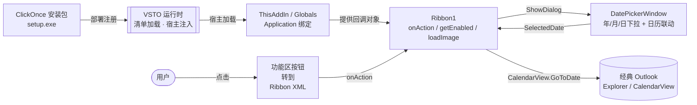
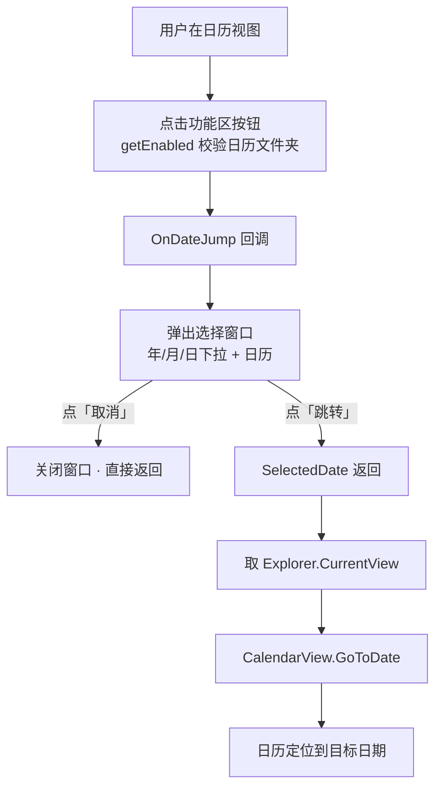
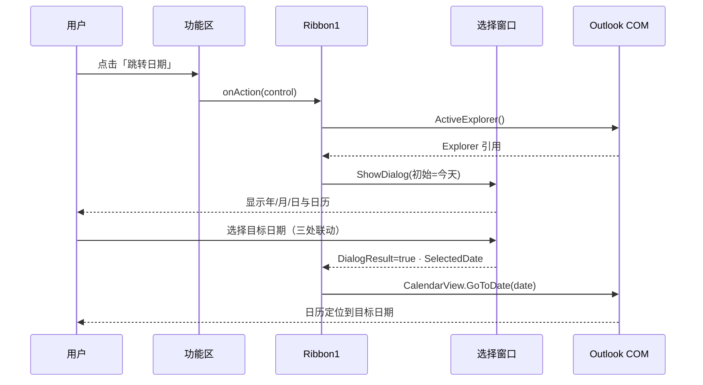
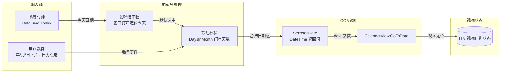
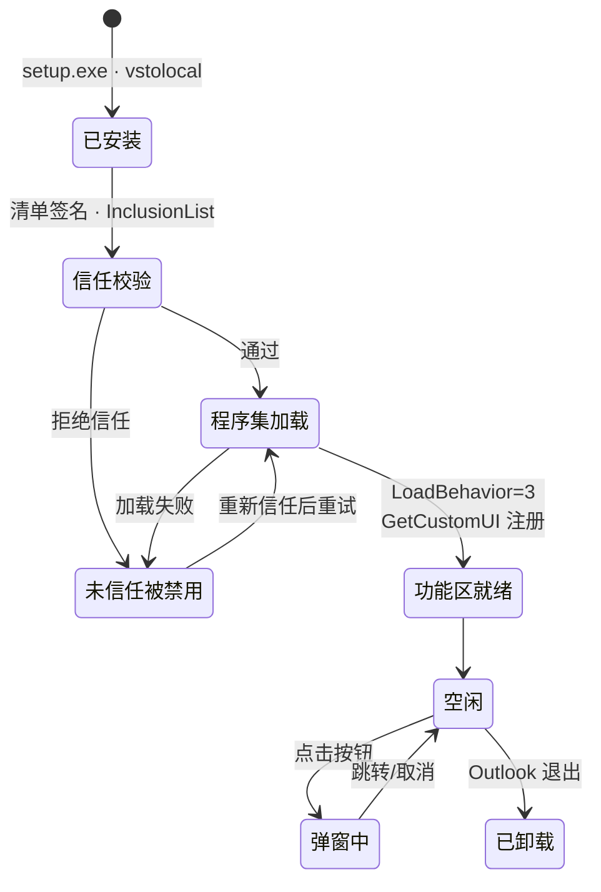

# Outlook 日期跳转（OutlookDateJump）

为经典版 Outlook 日历功能区添加**「跳转日期」大按钮**：点击弹出**年/月/日三下拉框 + 日历点选**的选择窗口，
三处选择彼此联动（天数随年月自动重算、含闰年），确认后日历视图立即跳转。
**双击日历上任意日期 = 直接跳转**，无需再点「跳转」按钮。
替代内置「转到日期」对话框只能手动录入、无法快速点选年份的交互。

- 产品名：Outlook 日期跳转
- 作者/版权：xiaoxiaoyu (379008610@qq.com) · Copyright © 2026 xiaoxiaoyu · 本项目以 [MIT 许可证](LICENSE) 开源
- 技术栈：VSTO 4.0 Add-in（C# / .NET Framework 4.7.2）+ Ribbon XML + WPF + Outlook COM

> **免责声明**：本项目为个人开发的第三方工具，与 Microsoft Corporation 无任何关联，未获 Microsoft 授权、赞助或认可。文中提及的「Microsoft」「Outlook」「Visual Studio」等名称均为 Microsoft Corporation 的商标，仅用于说明兼容性。使用本软件的风险与后果由使用者自行承担。
>
> 本项目包含第三方组件（HandyControl 等），许可信息详见 [THIRD-PARTY-NOTICES.md](THIRD-PARTY-NOTICES.md)。

---

## 支持的 Outlook 版本

| 环境 | 支持情况 |
|------|----------|
| 经典版 Outlook（Windows 桌面版）2013 / 2016 / 2019 / 2021 / 2024 | ✅ 支持 |
| Microsoft 365 桌面版 Outlook（经典通道，x86 / x64） | ✅ 支持 |
| 「新的 Outlook」（New Outlook / MONET 网页内核） | ❌ 不支持（网页内核无 COM/VSTO 通道） |
| Outlook for Mac / Outlook 网页版 (OWA) / 移动端 | ❌ 不支持 |

运行时依赖（安装程序自带引导，缺什么装什么）：

- .NET Framework 4.7.2
- Visual Studio 2010 Tools for Office Runtime（VSTO Runtime 4.0）
- Windows 7 SP1 及以上

> 判断方法：窗口标题栏为蓝色、功能区为传统多行样式即「经典版」；左上角标着「新的 Outlook」的环境无法加载本插件。

---

## 安装与发布

| 操作 | 方式 |
|------|------|
| 安装 | 双击 `OutlookDateJump/bin/Release/app.publish/setup.exe` |
| 卸载 | Windows「设置 → 应用」中卸载 Outlook 日期跳转 |
| 重新构建 | 双击 `OutlookDateJump/build_publish.cmd`（自动定位 MSBuild，无需开发者命令提示符） |
| 发布产物 | `OutlookDateJump/bin/Release/app.publish/`（setup.exe + OutlookDateJump.vsto） |

构建即自动注册到当前用户 Outlook（HKCU，LoadBehavior=3），重启 Outlook 即生效；
正式安装包供其他机器部署（首次启动弹出信任提示时点「安装」）。

---

## 系统架构图



交互版：[docs/diagrams/architecture.html](docs/diagrams/architecture.html)

## 功能区入口

**单一大按钮**，仅在日历文件夹中可用：

| 属性 | 值 |
|------|-----|
| 位置 | **日历模块的「开始」选项卡** → 「跳转」组，`insertBeforeMso="GroupCalendarNew"`（落在「新建」组之前） |
| 按钮 | `label="跳转日期"` · `size="large"` · 32×32 满格大图标 |
| 实测尺寸 | **42×76**，与内置「今天 / 天 / 周 / 月」等大按钮完全一致 |
| 组标题 | **必须非空**（`label="跳转"`） |

> 两条硬约束（都是实测踩出来的）：
> 1. **`<group label="">` 会让整个组不渲染**——按钮彻底消失，功能区里找不到自定义组。
> 2. **按钮不能叫「转到日期」**：Outlook 自带同名命令（「转到」组里的小按钮，点开是 304×177 的系统对话框），重名会让用户看到两个同名按钮，自动化也无法区分。改用唯一的「跳转日期」。

## 选择窗口（HandControl 美化）

界面基于 **HandControl 3.5.1**（国产 WPF UI 组件库，MIT 协议，零依赖，net472 目标框架）：

- **HandControl 自绘标题栏**（`hc:Window` + `NonClientAreaContent`）：40×40 圆角图标底板 + 32×32 清晰图标 + 21px 半粗标题 + 系统级关闭按钮
  - 系统标题栏的 16×16 小图标与小标题**已全部去掉**（不再设置 `this.Icon`），标题区只剩一处大图 + 一处大标题（UIA 实测：标题文本元素恰好 1 个，高 28px）
- 年/月/日三个 **HandControl ComboBox**，随窗口宽度自适应拉伸，17px 字号
- 日历置于圆角描边卡片内，**填满窗体剩余空间**（实测 568×558，占窗体 91.6% × 77.5%）
- 今天 / 跳转 / 取消 三按钮（96×38，17px），主题主色样式
- **双击日历任意一天 = 直接跳转**，无需再点「跳转」

主题加载（在 `WpfHelper` 创建 WPF Application 时合并进 `Application.Resources`）：

```csharp
pack://application:,,,/HandyControl;component/Themes/SkinDefault.xaml   // 皮肤（颜色变量）
pack://application:,,,/HandyControl;component/Themes/Theme.xaml          // 控件样式
```

> HandControl 的 `HandyControl.dll` 会随 ClickOnce 安装包一起分发（`Application Files/.../HandyControl.dll.deploy`），无需用户另行安装。

## 流程图



交互版：[docs/diagrams/workflow.html](docs/diagrams/workflow.html)

## 时序图



交互版：[docs/diagrams/sequence.html](docs/diagrams/sequence.html)

## 数据流图



交互版：[docs/diagrams/dataflow.html](docs/diagrams/dataflow.html)

## 生命周期图



交互版：[docs/diagrams/lifecycle.html](docs/diagrams/lifecycle.html)

---

## 核心原理

Outlook 对象模型提供 `View.GoToDate(DateTime)`。必须取 **`Explorer.CurrentView`**（而非 `Folder.CurrentView`）才能生效：

```csharp
var view = explorer.CurrentView as Outlook.CalendarView;
if (view != null) view.GoToDate(date);
```

## 关键实现要点（踩坑记录）

1. **Outlook 功能区 XML 不支持 `<ribbon>` 下单 `<tab idMso=...>` 简写**（Word/Excel 无此限制），会被静默忽略；必须写 `<ribbon><tabs><tab idMso="TabCalendar">…</tabs></ribbon>`。
2. **`getImage` 回调在 Outlook Explorer 功能区可能不被调用**（onLoad/onAction/getEnabled 正常时仍失灵）；改用 `<customUI loadImage="回调">` + 控件 `image="资源名"` 通道，回调签名 `IPictureDisp 回调名(string imageName)`。
3. **AxHost.GetIPictureDispFromPicture 是 protected**，须经 AxHost 子类调用（`PictureDispConverter : AxHost` 模式），反射 Public 找不到。
4. **功能区图标必须无 alpha 通道**：32bppArgb 位图转 IPictureDisp 后会被 Office 按全透明渲染（图标隐形）；用 `Format32bppRgb` + 白底缩放到 32×32。
5. **VSTO 加载项里弹 WPF 窗口**：`Application` 每 AppDomain 只能 `new` 一次，且必须设置 `ShutdownMode = OnExplicitShutdown`——默认 `OnLastWindowClose` 会在弹窗关闭时关掉 Outlook 主线程的 WPF Dispatcher（不可重启），之后弹窗永远静默失败。
6. **构建环境**：需 VS 2022 并安装「Office/SharePoint 开发」工作负载（VS 2026 已移除该工作负载，无法编译 VSTO）。
7. **Outlook 功能区布局限制**（实测）：
   - 组级 `insertBeforeMso` 只对部分内置组生效（`GroupCalendarNew` 有效）。
   - **`<group label="">` 空组标题 → 整个组不渲染**，按钮彻底消失（最隐蔽的坑）。
   - **按钮名不能与内置命令重名**：`label="转到日期"` 会与 Outlook 自带的同名命令冲突，用户看到两个同名按钮。
   - `autoScale="false"` 是反模式：Office 只能压扁按钮宽度，导致标签逐字竖排；应设 `autoScale="true"`。
   - 自定义组被压到约 42~58px 时，`size="large"` 的按钮尺寸是 **W=42 H=76**（与内置「今天/天/周/月」完全一致），`H > W` 属正常大按钮形态，不是竖排。
   - 验证 UI 布局用 UI Automation 读 `BoundingRectangle`，不要靠截图。
8. **「点两次才跳转」的真正成因与最终解法**（多轮排查结论）：
   - **成因一：跳转发生在模态消息循环里**。`ShowDialog()` 返回前 Outlook 仍在模态收尾，此时 `GoToDate` 会被静默丢弃。
   - **成因二：按键点击被用于"激活窗口"**。弹窗未取得前台焦点时，第一次真实鼠标点击被 Windows 吃掉，按钮 handler 根本不会进。
   - **成因三：在模态期间调用 `explorer.Activate()`**——owner 窗口被禁用，必然失败，还会抢走弹窗焦点。
   - **成因四：`Marshal.ReleaseComObject(explorer.CurrentView)`**——Outlook 跨调用复用该 RCW，提前释放后再取会拿到失效对象，典型症状就是"第一次无效、第二次才生效"。
   - **最终架构**：点「跳转」只做两件事（记录 `SelectedDate` + `DialogResult = true`），**点击路径里零 COM 调用**，窗口立刻关闭；跳转由宿主在 `ShowDialog()` 返回后执行——先立即跳一次，再用 **WinForms Timer** 补 3 拍（`80ms`）兜底。同时用 `Owner = Outlook 主窗口` + `AttachThreadInput` 强制前台，消除激活点击。
   - 重试定时器必须用 **WinForms Timer**（Win32 消息循环驱动）——WPF `DispatcherTimer` 在模态关闭后 Dispatcher 不再泵消息，根本不触发。
   - 跳转顺序：**先 `Apply()` 再 `GoToDate()`**（反过来会把视图重置回原位）。
   - 客观验证方式：读日历视图标题按钮的 UIA Name（含「事件总数」锚点），例如 `后退,月视图, 2026年 10月 ，23 事件总数` → 跳转后变成 `2026年 12月`。
9. **HandControl 3.5.1 集成**：
   - XAML 命名空间 `https://handyorg.github.io/handycontrol`；**没有 `hc:Button`**（按钮用原生 `Button` + 主题默认样式）。
   - 根元素换成 `hc:Window` 后，代码隐藏基类必须同步为 `HandyControl.Controls.Window`，否则 CS0263「分部声明基类不一致」。
   - 主题资源实际是 `HandyControl.g.resources` 里的 BAML（`themes/skindefault.baml`、`themes/theme.baml`）。

## 零编译替代版

`OutlookDateJump.ps1` 是功能等同的 PowerShell 版（WPF 内联 XAML + COM 跳转，无需安装任何东西），
适合无法安装加载项的机器；桌面快捷方式 `Outlook日期跳转.cmd` 一键启动。

## 项目结构

```
OutlookSelectDate/
├── OutlookDateJump.ps1        零编译 PowerShell 版（双击即用，功能等同）
├── README.md                  本文档
├── LICENSE                    MIT 许可证
├── THIRD-PARTY-NOTICES.md     第三方组件许可声明（HandyControl 等）
├── Calendar.png               功能区按钮/弹窗标题栏图标源图（AI 生成）
├── LOGO.png                   产品 logo 源图（AI 生成，PowerShell 版窗口图标）
├── lib/
│   ├── HandyControl.dll       WPF 组件库（csproj 以相对路径引用，克隆即可编译）
│   └── HandyControl-LICENSE.txt   HandyControl 的 MIT 许可证全文
├── tools/
│   ├── build_publish.cmd      一键构建 + ClickOnce 发布（正式产物）
│   ├── compile_check.cmd      编译检查（输出到 obj\scratch，不碰 bin\Release）
│   ├── make_icon.ps1          由 Calendar.png 生成 64×64 CalendarIcon.png
│   ├── verify_uia.py          无头验证：UIA 触发按钮 + 实测弹窗
│   ├── verify_combos.py       无头验证：三下拉滑动窗口 ±5 行为
│   └── revision.txt           构建版本号（ASCII 文件，递增）
├── OutlookDateJump.sln        解决方案
├── poc_gotodate.ps1           GoToDate 早期概念验证脚本
├── docs/
│   ├── diagrams/              5 张交互式 HTML 图（架构/流程/时序/数据流/生命周期）
│   └── archify/               图的 JSON 源与渲染日志
└── OutlookDateJump/           VSTO 工程
    ├── OutlookDateJump.csproj
    ├── ThisAddIn.cs / ThisAddIn.Designer.cs / .Designer.xml   入口与运行时管线
    ├── Ribbon1.cs / Ribbon1.xml                                功能区回调与 XML
    ├── RibbonImageHelper.cs                                    图标 → IPictureDisp
    ├── DatePickerWindow.xaml(.cs)                              年/月/日 + 日历选择窗口
    ├── WpfHelper.cs                                            WPF 宿主（Application 复用）
    └── build_publish.cmd                                       一键构建 + ClickOnce 发布
```
